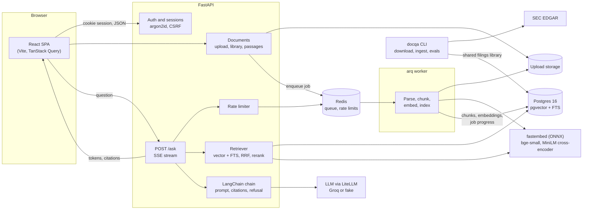

# Document Q&A Assistant

[](https://github.com/HarshaM30/document-qa-assistant/actions/workflows/ci.yml)

Ask plain-English questions about SEC 10-K filings and your own PDFs. Answers stream in
with numbered citations that open the exact passage they came from, and the assistant
says so when the documents don't contain the answer instead of guessing. Retrieval and
answer quality are measured against a hand-built, source-verified question set.


The demo is recorded by `make demo-gif`, a scripted browser session against the real
answer model over the 15 indexed filings.

## What it does

- **Hybrid retrieval over 10-Ks and PDFs.** pgvector (HNSW) and Postgres full-text search,
  fused with reciprocal rank fusion and reranked by a cross-encoder. Companies and fiscal
  years named in a question narrow the search to the matching filings.
- **Tables kept intact.** Each 10-K table becomes its own chunk, rendered as
  `Row label | Column: value` lines with the caption and units, so numbers stay attached to
  their meaning.
- **Streamed, cited answers.** Server-sent events carry tokens, then a `citations` event
  mapping each `[n]` to a document, Item or page, and passage.
- **Principled refusals.** Two layers: a rerank-score gate that refuses before calling the
  LLM, and a fixed refusal sentence the server detects.
- **Measured.** A 50-question held-out test set and a 25-question dev set, each answer
  backed by a verbatim source quote, with numeric answers cross-checked against SEC XBRL
  data. Retrieval ablations, a resumable LLM-judged generation eval, and a human check of
  the judge.
- **Production concerns.** Cookie sessions with argon2id, CSRF and tenancy checks,
  per-user rate limits, a background ingestion worker with retries, structured logs with
  request IDs, timeouts, cancellation on disconnect, and a load test.

Everything runs locally. Embeddings and reranking run on CPU through ONNX (no PyTorch),
and answers come from `openai/gpt-oss-120b` on Groq's free tier, or from a deterministic
fake model that needs no key.

## Architecture



**Ingestion.** An upload creates a document and an `ingestion_jobs` row, then queues an
arq job. The worker parses (pdfplumber for PDFs; a custom parser for inline-XBRL 10-K
HTML that splits filings into Items and tables), chunks with the embedding model's
tokenizer, embeds, and indexes, recording stage and progress in Postgres for the UI to
poll. Failures retry with exponential backoff; unreadable files fail at once with a
readable error. The 15 10-Ks are ingested once by `docqa ingest-filings` into a shared,
read-only library that any workspace can attach. Uploads stay private to their workspace.

**Answering.** `POST /workspaces/{id}/ask` checks the rate limit, retrieves (30 vector + 30
keyword candidates → RRF → cross-encoder over 30 → top 6), refuses if nothing clears the
score gate, and otherwise streams the model's answer. Citation markers are resolved
server-side to chunks, and every question and answer is stored with its status
(`complete`, `failed`, or `stopped`), so a refresh shows exactly what the user saw.

**Tenancy.** Every retrieval and passage lookup goes through one scoping function: chunks
from the workspace's own uploads plus the library filings it has attached. Workspace
ownership is checked against the session user, and tests cover cross-user access.

## Quickstart (Docker)

Prerequisites: Docker, [uv](https://docs.astral.sh/uv/), Node 26, and `make`. The stack
binds Postgres to host port **5434**, Redis to **6380**, the API to **8000**, and the web
app to **5173**.

```bash
git clone https://github.com/HarshaM30/document-qa-assistant.git
cd document-qa-assistant
make setup        # uv sync + npm ci; creates .env from .env.example
```

Edit `.env`:

- `SESSION_SECRET_KEY`: set it to the output of
  `python3 -c "import secrets; print(secrets.token_urlsafe(64))"`.
- `GROQ_API_KEY`: a free key from [console.groq.com](https://console.groq.com). To try the
  app without one, set `LLM_PROVIDER=fake` (a deterministic extractive model).
- Optionally change `POSTGRES_PASSWORD`, and update `DATABASE_URL` and `TEST_DATABASE_URL`
  to match.

```bash
make up           # builds and starts Postgres, Redis, API, worker, and frontend
```

Open <http://localhost:5173>, sign up, create a workspace, and upload a PDF. The first
ingestion and the first question download the embedding and reranker models (about
150 MB, cached in a Docker volume). `curl localhost:8000/health` reports the database,
Redis, and model files. `make down` stops the stack and keeps its data.

### Adding the SEC 10-K library

The 15 filings (Apple, Microsoft, Amazon, JPMorgan Chase, and Johnson & Johnson, three
most recent 10-Ks each) are pinned by accession number and SHA-256 in
[`data/filings.lock.json`](data/filings.lock.json). SEC asks automated clients to identify
themselves, so set `SEC_USER_AGENT` in `.env` to your name and email first.

```bash
make download         # fetch exactly the locked filings into data/raw, verify SHA-256s
make ingest-filings   # parse, chunk, embed, and index them (about 10 minutes on a laptop)
```

Then use **Attach all** on a workspace's Documents page.

### Running on the host (development)

```bash
make deps migrate     # Postgres + Redis in Docker, then migrations
make dev-api          # http://localhost:8000 (OpenAPI docs at /docs)
make dev-worker
make dev-web          # http://localhost:5173
```

## Tests and CI

```bash
make lint typecheck   # ruff + mypy, ESLint + tsc
make test-unit        # 171 tests, no services needed
make test-int         # 69 tests against real Postgres + Redis (fake LLM)
make e2e              # Playwright: sign up → upload → ask → open citation, auth, stream errors, rate limit
```

GitHub Actions runs the same checks as separate jobs on every push: backend lint and
typecheck, unit tests, integration tests with pgvector and Redis service containers (plus
a migrate-up, migrate-down check), the frontend build, and the Playwright suite. CI, the
E2E tests, and the load test use only the fake LLM and need no secrets.

## Results

All numbers come from committed reports in [`evals/reports/`](evals/reports/) and
[`benchmarks/results.md`](benchmarks/results.md), produced by the `make` targets shown.

### Evaluation data

- **Test set** [`qa_v1`](evals/datasets/qa_v1.jsonl): 50 questions: 12 factual, 12 table
  lookups, 8 year-over-year, 8 cross-company, and 10 unanswerable (companies or years
  outside the corpus). It is held out: no tuning decision used it.
- **Dev set** [`dev_v1`](evals/datasets/dev_v1.jsonl): 25 different questions in the same
  proportions, used for every retrieval decision.
- Every gold answer carries a verbatim source quote that `make eval-verify` finds in the
  stated Item of the parsed filing. Every numeric answer carries an XBRL concept that
  `make eval-xbrl` checks against SEC's `companyfacts` API (0 unexplained mismatches).

### Retrieval on the held-out test set

Recall@k is the share of a question's gold sources with a matching chunk in the top k
(40 answerable questions); MRR is the mean reciprocal rank of the first gold chunk. No LLM
is involved. "Before" is hybrid search plus rerank; "after" adds the company and
fiscal-year filter and per-company decomposition chosen on the dev set
([report](evals/reports/20261119T053241Z-before-after.md)).

| Metric | Before | After |
|---|---:|---:|
| Recall@5 | 27.5% | **45.0%** |
| Recall@10 | 42.5% | **62.5%** |
| MRR | 0.181 | **0.310** |
| Mean latency (CPU) | 1.03 s | 1.41 s |

| Category | Recall@10 before → after |
|---|---|
| Table lookups | 50.0% → 83.3% |
| Factual | 50.0% → 66.7% |
| Cross-company | 25.0% → 50.0% |
| Year-over-year | 37.5% → 37.5% |

On the dev set the same changes took recall@10 from 47.5% to 87.5%. The smaller gain on
the test set is the expected cost of choosing on a separate set.

### Ablations (test set, before tuning)

From [`20261118T032011Z-ablations.md`](evals/reports/20261118T032011Z-ablations.md); each
variant retrieves the top 10.

| Variant | Recall@10 | MRR |
|---|---:|---:|
| Vector only | 27.5% | 0.128 |
| Keyword only | 8.8% | 0.079 |
| Hybrid (RRF) | 31.2% | 0.167 |
| Hybrid + cross-encoder rerank | 42.5% | 0.181 |
| Chunk size 256 / 512 / 1024 | 47.5% / 42.5% / 48.8% | 0.270 / 0.181 / 0.196 |
| Naive fixed windows (512) | 57.5% | 0.280 |

Hybrid search beats either retriever alone, and the reranker adds 11 points of recall@10.
Naive chunking looked better here, but after the metadata filter and decomposition it
scored 72.5% against 87.5% for section-aware chunking on the dev set
([tuning report](evals/reports/20261119T050513Z-tuning.md)), so section-aware chunking
stayed.

### Generation on the held-out test set

Answer model `openai/gpt-oss-120b`; judge `qwen/qwen3.8-27b`, a different model family to
reduce self-preference ([report](evals/reports/20261119T053223Z-generation.md)).

| Metric | Before | After | Definition |
|---|---:|---:|---|
| Numeric correctness | 47.2% | **55.6%** | every gold number stated (±1%, any scale); refusals count as wrong |
| Citation correctness | 47.8% | **65.5%** | a cited passage contains the gold quote |
| Gold passage in prompt | 35.0% | **60.0%** | retrieval put a gold chunk in the context |
| Refusal recall | 100% | 100% | unanswerable questions refused |
| Refusal precision | 37.0% | 47.6% | refusals that were for unanswerable questions |
| Faithfulness (judge) | 95.7% | **100%** | every claim supported by the passages |

The judge was checked by hand on 20 answers: 100% agreement, Cohen's kappa 1.00
([report](evals/reports/20261119T032905Z-human-agreement.md)). By category, table lookups
score 83% numeric correctness, while cross-company questions score 25%: those answers are
faithful but often refused when one company's figure isn't retrieved.

The generation eval runs within Groq's free tier: it checkpoints every answer to JSONL
keyed by question and config hash, keeps per-model daily request and token budgets plus a
tokens-per-minute limit, honors `retry-after`, and resumes where it stopped. A full run
takes about 25 minutes and about 115K tokens on the answer model.

### Load and ingestion

Locust against one API process on an Apple M5 laptop, with the fake LLM (so the numbers
measure the app: auth, Postgres, hybrid retrieval, the cross-encoder, and SSE), over the
15 filings ([full results](benchmarks/results.md)).

| Users | Full answer p50 | p95 | Document list p95 | Error rate | API peak memory |
|---:|---:|---:|---:|---:|---:|
| 1 | 1.2 s | 4.0 s | 15 ms | 0% | 0.96 GB |
| 5 | 1.8 s | 7.0 s | 19 ms | 0% | 1.21 GB |
| 10 | 2.6 s | 9.3 s | 13 ms | 0% | 1.40 GB |
| 25 | 16 s | 47 s | 180 ms | 0% | 1.57 GB |

At 25 users the API is CPU-bound on the cross-encoder (about 0.9 questions per second per
process), so answers queue while other endpoints stay fast. The load test found three
problems that are now fixed: unbounded concurrent model calls (memory), database
connections held while waiting for the models, and argon2 hashing on the event loop.

Ingestion with one worker job: **209 pages/min** for the HTML filings and **260 pages/min**
for 10-Ks printed to PDF. Embedding takes 95% of the time; a second concurrent job adds
7–25% throughput but doubles peak memory, so the worker runs one job at a time.

## Design decisions

The full list, with reasons, is in [PLAN.md §2](PLAN.md#2-key-design-decisions). Some of
the decisions:

| Area | Decision |
|---|---|
| Sessions | Opaque random token in an `HttpOnly`, `SameSite=Lax` cookie; only an HMAC of it is stored, so logout revokes and a leaked table can't be replayed |
| CSRF | SameSite cookie plus a required `X-Requested-With` header and a strict CORS origin |
| Models | `bge-small-en-v1.5` embeddings (384-d) and an MS MARCO MiniLM cross-encoder via fastembed (ONNX); reranking in batches of 4 keeps peak memory near 720 MB at the same speed |
| Keyword search | Generated `tsvector` with a GIN index; question terms are OR-ed, because `websearch_to_tsquery` ANDs every word and natural-language questions rarely match |
| Metadata filter | Company names and aliases (AWS, J&J) and fiscal years in the question restrict retrieval to matching filings; multi-company questions run one retrieval per company |
| Refusal | Rerank-score gate before the LLM call, then a fixed refusal sentence detected server-side, so refusals are cheap and measurable |
| Fake LLM | A LiteLLM custom provider that streams a deterministic extractive answer with citations; tests, CI, E2E, and load tests never call a real model |
| Ablation indexes | Chunk variants share the `chunks` table under an `index_config` key, so experiments need no schema changes |
| Reproducible corpus | The "latest three 10-Ks" are resolved once and pinned in a lockfile with SHA-256s; the downloader honors SEC's user-agent and rate-limit rules |

## Limitations

- **Year-over-year retrieval is weak.** Recall@10 is 37.5% on the test set, unchanged by
  tuning. The prior-year figure often sits in a different chunk or filing than the
  current one, and per-year decomposition hurt on the dev set.
- **Over-refusal.** Refusal recall is 100%, but under half of refusals are for questions
  that were truly unanswerable: when a needed passage isn't retrieved, the model refuses
  rather than answering partially.
- **Small evaluation sets.** With 40 answerable test questions, one question moves
  recall by 2.5 points. Treat differences of a few points as noise.
- **CPU-bound reranking.** One API process answers about 0.9 questions per second;
  scaling means more processes, each holding its own model copy (about 1 GB), or fewer
  rerank candidates.
- **PDF parsing.** pdfplumber reads text-based PDFs only: scanned (image-only) PDFs fail
  ingestion with an error (no OCR), and PDF tables are only as good as `extract_tables`
  detection.
- **Fixed corpus.** The library covers five companies, and the metadata filter recognizes
  them by registered name and a short alias list, so it can't narrow uploaded documents.
- **Free-tier models.** Groq limits each model to about 8K tokens per minute and 1K
  requests per day. The judge is a preview model, with `openai/gpt-oss-20b` as fallback.

## Deploying to the cloud

This project is not deployed anywhere; it runs locally. This section is a guide to what a
deployment would need.

1. **Postgres with pgvector.** Use a managed Postgres 16 that offers the `vector`
   extension. Run `alembic upgrade head` as a release step before new API versions start.
   Size `DB_POOL_SIZE` × API processes under the server's connection limit.
2. **Redis.** Any managed Redis works for the arq queue and rate limits. Turn on
   persistence so queued jobs survive a restart.
3. **API and worker.** Both use `backend/Dockerfile`. Run `docqa download-models` at build
   time (or mount a volume) and set `MODEL_FILES_CHECK=require` so an instance without its
   models fails fast instead of downloading on the first request. Budget about 1.8 GB of
   memory per API process and per worker (see the benchmarks), and scale the API by
   process count.
4. **Upload storage.** Uploads go to local disk (`UPLOAD_DIR`), which the API writes and
   the worker reads. Either mount one shared volume into both, or replace `storage.py`
   with object storage (S3 or compatible) before running more than one machine.
5. **Frontend.** `npm run build` with `VITE_API_BASE_URL` set to the API's public URL, then
   serve `frontend/dist` from a CDN or the included nginx image. Unknown paths must fall
   back to `index.html`.
6. **Cookies and CORS.** Serve the app and API from the same site (for example
   `app.example.com` and `api.example.com`) so the `SameSite=Lax` cookie is sent. Set
   `SESSION_COOKIE_SECURE=true`, terminate HTTPS at the load balancer, and set
   `FRONTEND_ORIGIN` to the app's exact origin.
7. **Streaming.** Disable response buffering and allow long-lived responses on any proxy
   in front of `/ask` (the API already sends `X-Accel-Buffering: no`). Keep the idle
   timeout above `ANSWER_TIMEOUT_SECONDS`.
8. **Secrets and config.** Supply `SESSION_SECRET_KEY`, the database password, and the
   LLM key from a secrets manager; every other setting is an environment variable listed
   in [`.env.example`](.env.example). Set `APP_ENV=production`.
9. **Observability.** Logs are one JSON object per line with a `request_id` (also returned
   as `X-Request-ID`) and a job ID in the worker, ready for any log aggregator. `/health`
   serves as the liveness and readiness check.
10. **LLM quota.** The per-user limits (5 questions per minute, 100 per day) protect a
    free-tier key. A public deployment needs a paid tier or lower limits.

## Project layout

```
backend/src/docqa/   FastAPI app, auth, ingestion, retrieval, generation, worker, evals, CLI
backend/tests/       unit and integration tests (fixtures: a 10-K excerpt and a small PDF)
frontend/            React + TypeScript SPA; Playwright tests in frontend/e2e
evals/               datasets, eval configs, generation checkpoints, timestamped reports
benchmarks/          Locust load test, ingestion benchmark, results.md
data/                companies.yaml and the filings lockfile (raw filings are downloaded)
docs/                demo GIF and the script that records it
```

`make help` lists every command. [PLAN.md](PLAN.md) records the milestones, design
decisions, and how each was verified.
